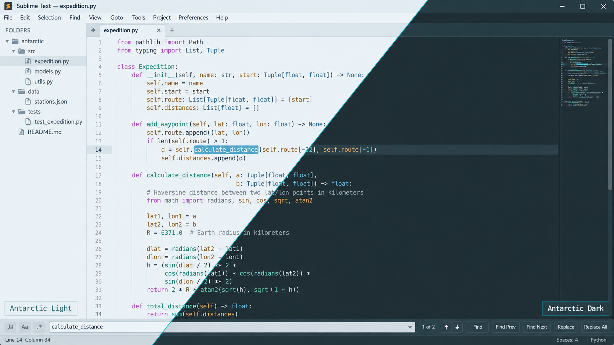

# Antarctic for Sublime Text

Light and dark themes based on the shared [Antarctic palette](https://github.com/AntarcticTheme/.github/blob/main/profile/README.md).



## Requirements

Install [Sublime Text](https://www.sublimetext.com/download) 3.1 or later. 

These are `.sublime-color-scheme` files, no plugin required.

## Install

Requires Sublime Text 3.1+; Sublime Text 4 is recommended. 

Choose **Preferences → Browse Packages…**, then open or create the `User` directory.

Download and copy both files from this repository's `themes` folder into `Packages/User`:

- [Antarctic Light](https://raw.githubusercontent.com/AntarcticTheme/Sublime-Text/main/themes/Antarctic-Light.sublime-color-scheme)
- [Antarctic Dark](https://raw.githubusercontent.com/AntarcticTheme/Sublime-Text/main/themes/Antarctic-Dark.sublime-color-scheme)

Choose **Preferences → Select Color Scheme…** and select the desired variant. Alternatively edit this into your user preferences:

```json
{
  "color_scheme": "Antarctic-Dark.sublime-color-scheme"
}
```

Use `Antarctic-Light.sublime-color-scheme` for light mode. The files color the editor, gutter, syntax, caret, selection, search, and guides. They are color schemes; sidebar, buttons, and tabs are controlled by your separately selected Sublime UI theme.

## Updates

To update, repeat the download/copy steps, then restart the application or reload its configuration.

Released under the MIT license. See [LICENSE](LICENSE).
